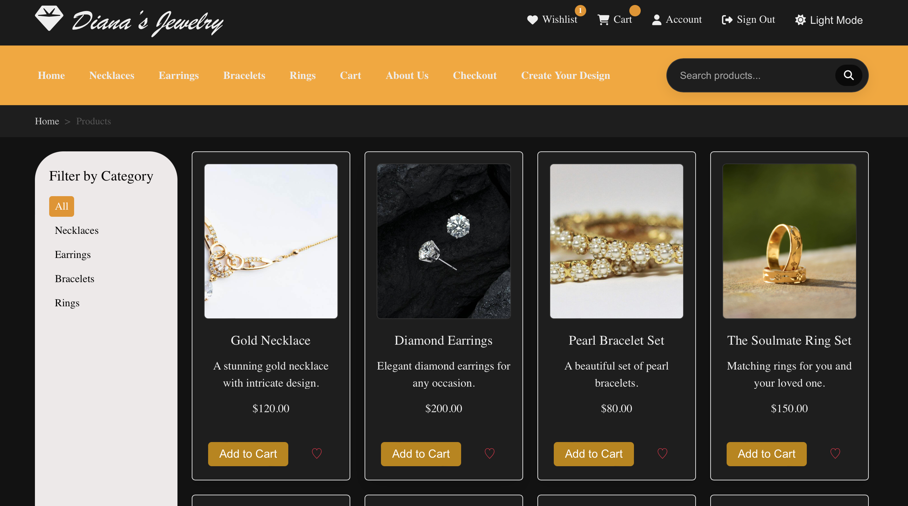
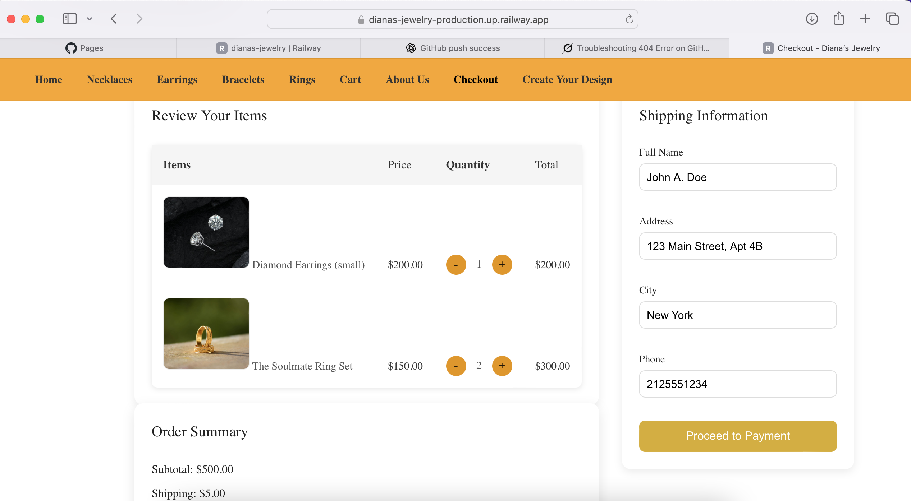
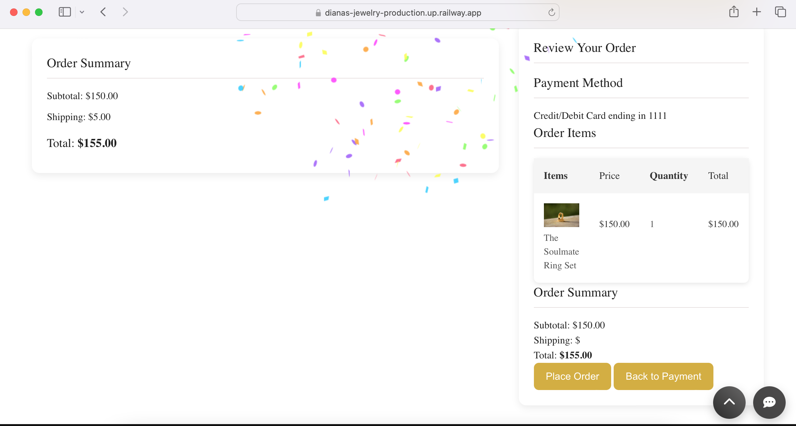

# 💎 Diana's Jewelry

**Full-stack jewelry e-commerce site with an AI shopping assistant.**

🔗 **Live demo:** https://dianas-jewelry.onrender.com
> Hosted on Render's free tier: the first load after a quiet period can take up to a minute while the server wakes up.

---

## 🌟 Overview

Diana's Jewelry is a full-stack e-commerce website for a small jewelry business. Customers can browse products by category, manage a cart and wishlist, place orders, request custom designs, and ask an AI assistant about products.

The backend is a Node.js/Express REST API backed by MySQL. The frontend is served from the same server, so the whole app runs as a single deployable service.

---

## ⚡ Features

**Shopping**
- Product catalogue loaded from MySQL, filterable by category (necklaces, earrings, bracelets, rings)
- Product detail pages with variants and related products
- Shopping cart with quantity updates
- Wishlist
- Multi-step checkout (shipping → payment → review) with order history

**AI**
- AI shopping assistant powered by Groq (`openai/gpt-oss-120b`) that answers from the live product catalogue, with real names and prices
- AI-powered product search over the catalogue
- Automatic retries when the AI provider is busy, a typing indicator, and clear fallback messages
- Google Gemini supported as an alternative provider, switchable with one environment variable
- The store keeps working if the AI service is unavailable; only the AI features are switched off

**Customer engagement**
- Custom jewelry order requests
- Feedback form and newsletter sign-up
- Dark mode and fully responsive layout

---

## 🛠️ Tech Stack

| Layer | Technology |
|---|---|
| Backend | Node.js, Express.js (REST API) |
| Frontend | HTML, CSS, JavaScript, jQuery |
| Database | MySQL 8 (`mysql2` connection pool) |
| AI | Groq (`openai/gpt-oss-120b`) via the OpenAI SDK; Google Gemini as an alternative |
| Hosting | Render (app), Aiven (managed MySQL with SSL) |
| Version control | Git & GitHub |

---

## 🖼️ Screenshots

<table>
  <tr>
    <td align="center" width="50%">
      <br>
      <sub><b>Home page</b> – hero slider and featured collections</sub>
    </td>
    <td align="center" width="50%">
      <br>
      <sub><b>Product catalogue</b> – category filters loaded from MySQL</sub>
    </td>
  </tr>
  <tr>
    <td align="center" width="50%">
      <br>
      <sub><b>Shopping cart</b> – quantities and order total</sub>
    </td>
    <td align="center" width="50%">
      <br>
      <sub><b>Checkout</b> – order review and confirmation</sub>
    </td>
  </tr>
  <tr>
    <td align="center" colspan="2">
      <br>
      <sub><b>AI shopping assistant</b> – answers from the live catalogue with real products and prices</sub>
    </td>
  </tr>
</table>

---

## 🚀 Getting Started

### Prerequisites
- Node.js 18+
- MySQL 8 (local, or a hosted database such as Aiven)
- Git

### 1. Clone and install

```bash
git clone https://github.com/aqsak-dev99/dianas-jewelry.git
cd dianas-jewelry
npm install
```

### 2. Set up the database

Create a database and import the provided SQL file:

```bash
mysql -u root -p -e "CREATE DATABASE dianas_jewelry;"
mysql -u root -p dianas_jewelry < dianas_jewelry.sql
```

### 3. Configure environment variables

Create a `.env` file in the project root:

```env
DB_HOST=localhost
DB_PORT=3306
DB_USER=root
DB_PASSWORD=your_password
DB_NAME=dianas_jewelry
DB_SSL=false          # set to true for hosted MySQL such as Aiven
GROQ_API_KEY=your_groq_key       # AI assistant (Groq)
GEMINI_API_KEY=your_gemini_key   # optional: used only when no Groq key is set
PORT=5000
```

### 4. Run the app

```bash
node server.js
```

Open **http://localhost:5000**. Press `Ctrl + C` to stop the server.

---

## 🔌 API Overview

| Area | Endpoints |
|---|---|
| Products | `GET /api/products`, `GET /api/products/:id` |
| Categories | `GET /api/categories`, `GET /api/categories/:id` |
| Cart | `GET /api/cart`, `POST /api/cart/add`, `PUT /api/cart/update/:product_id`, `DELETE /api/cart/remove/:product_id`, `DELETE /api/cart/clear` |
| Wishlist | `GET /api/wishlist`, `POST /api/wishlist/add`, `DELETE /api/wishlist/remove/:product_id` |
| Orders | `POST /api/orders`, `GET /api/orders`, `GET /api/order_items/:orderId` |
| AI | `POST /api/chat`, `POST /api/ask` |
| Other | `POST /api/newsletter`, `POST /api/feedback`, `POST /api/customers/signup` |

---

## ☁️ Deployment

- **App:** Render web service (build `npm install`, start `node server.js`), redeployed automatically on every push to `main`
- **Database:** Aiven managed MySQL over SSL
- Configuration is supplied through environment variables; no secrets are stored in the repository

---

## 🧭 Planned Improvements

Not built yet; these are the next steps for the project:

- JWT authentication (currently uses a demo user)
- Password hashing with bcrypt
- Payment gateway integration
- Admin dashboard for managing products and orders

---

## 👩‍💻 Author

**Aqsa Khan**: [GitHub](https://github.com/aqsak-dev99) · [LinkedIn](https://www.linkedin.com/in/aqsa-khan-dev/)
